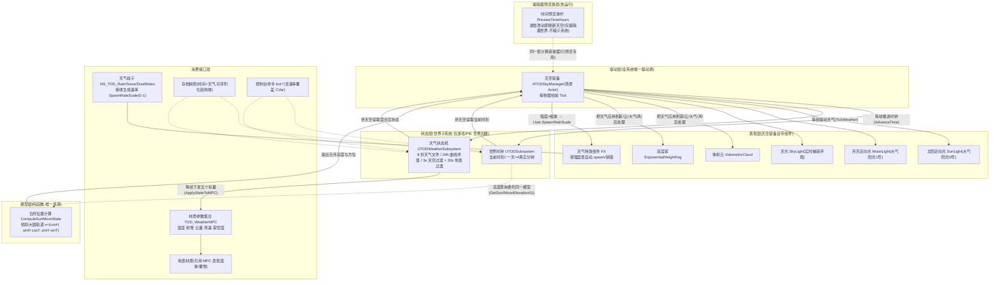
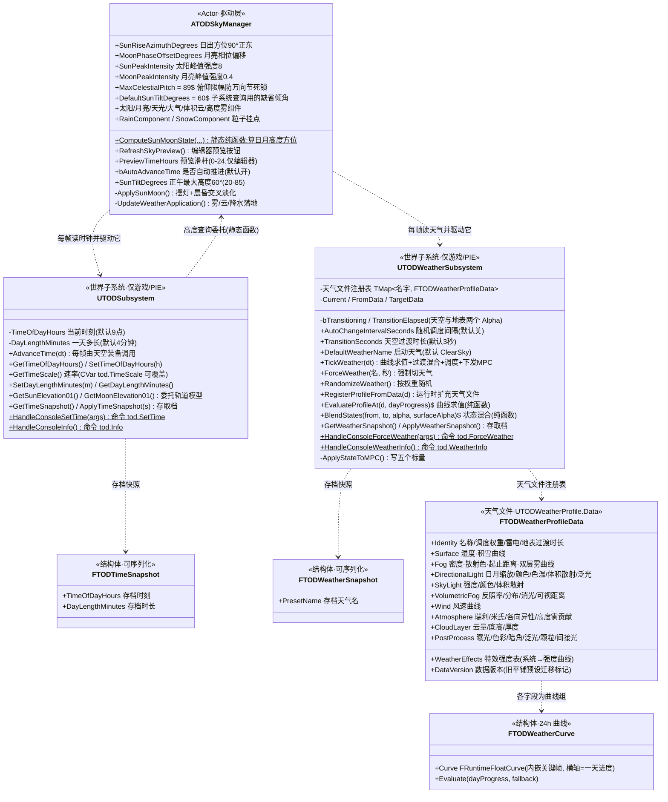
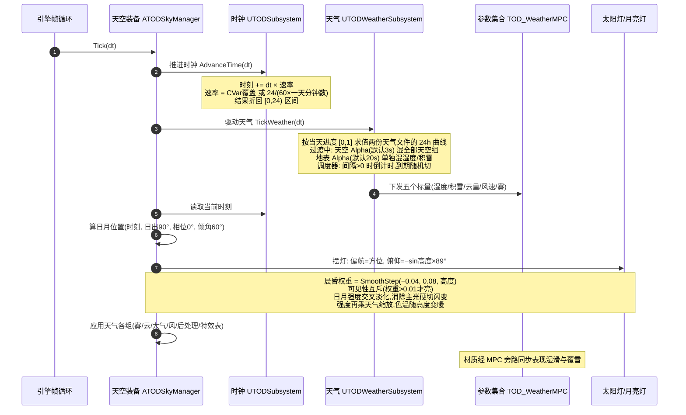
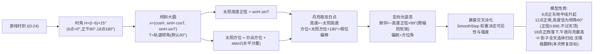
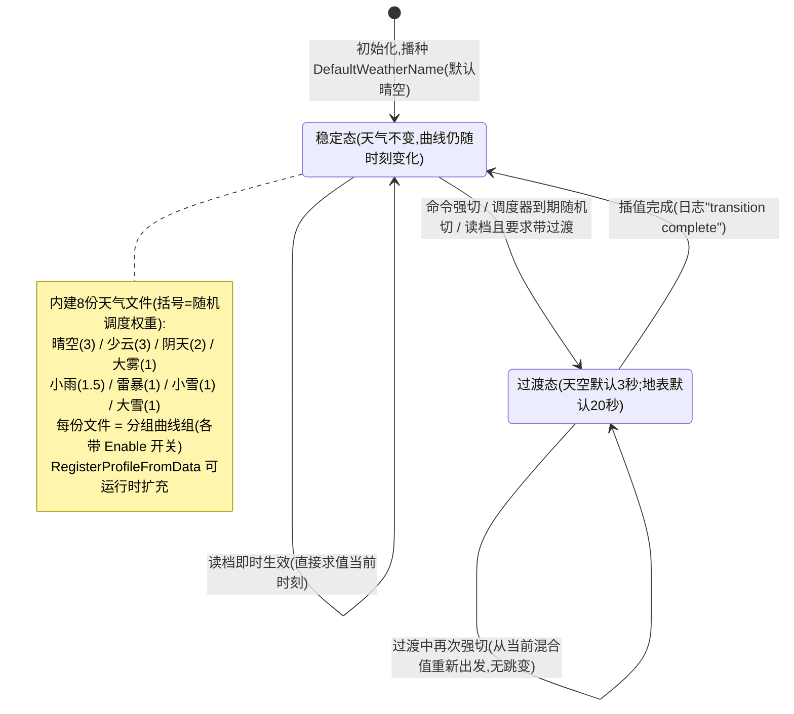
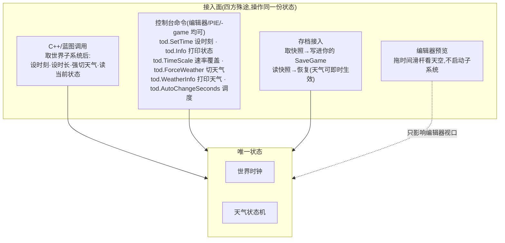
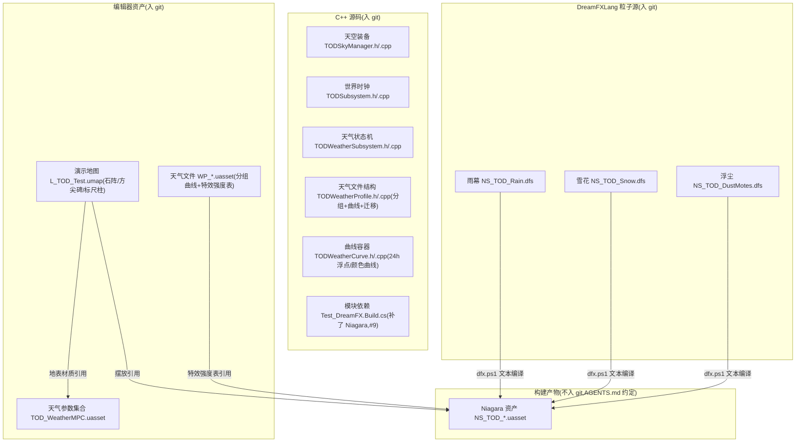

# TOD 昼夜与天气系统 —— 架构图(Mermaid)

> 对应提交:`#9`(昼夜/轨道)、`#10`(天气/MPC/存档)、`#11`(雨雪粒子,搁置待上游)。
> 源码位置:`Source/Test_DreamFX/TOD/`,粒子源:`DFX/TOD/Niagara/`,资产:`Content/TOD/`。
> 运行验证结论(2026-10-21):时钟推进、倾斜轨道数学、日月互斥、天气过渡/调度/MPC 下发全部实测通过。
> 图例约定:**方框/连线文字以中文说明为主**,括号内保留代码标识符以便对照源码。

## 1. 分层架构总览

要点:

- **状态与驱动分离**:两个子系统从不自己 tick;"天空装备"是时钟与天气的唯一驱动源(关卡里没有它 ⇒ 时间不流动)。
- **轨道模型同源**:运行时、编辑器预览、类默认姿态、子系统高度查询全部走 `ComputeSunMoonState` 这一个纯函数——消除两套实现漂移(`#9` 修复点)。
- **天气混合出口有二**:天空装备消费缩放值(阳光/月光/天光/雾/云/雨雪),MPC 是材质侧的旁路广播。

## 2. 类与职责

## 3. 每帧运行时数据流(游戏世界)

## 4. 太阳/月亮轨道模型(`#9` 核心)

## 5. 天气状态机

## 6. 外部接口矩阵

## 7. 源码 / 资产布局

## 8. 已知边界(与设计一致,非缺陷)

| 项 | 现状 | 出处 |
|---|---|---|
| 雨/雪粒子不渲染 | SpawnRate 型发射器引擎侧缺陷,已搁置待上游;协议接线完好,修复后 `dfx.ps1 build -All -Force` 零改动点亮 | DFX/TOD/README.md · `#11` |
| 编辑器视口不驱动天气 | 子系统仅 Game/PIE 创建;预览请用 PreviewTimeHours + PreviewWeatherProfile(走同一套 `EvaluateProfileAt`) | 08-使用说明 |
| 云量仅整层显隐 | `CloudCoverage>0.02` 开关云层;材质级覆盖属 M3+ 计划 | TODSkyManager.cpp |
| 闪电未实现 | `Identity.bLightning` 已随天气文件保存,M4 消费 | TODWeatherSubsystem.h |
| 分组开关语义 | 组关闭时该组组件保持最后一次取值(不做淡出);需要淡出时用曲线归零 | TODWeatherSubsystem.h |
| 天气文件为二进制资产 | 曲线在编辑器 Curve Editor 里调,不能在文本 diff;改数值请用资产编辑器或 `asset` 读回导出 | 08-使用说明 |
